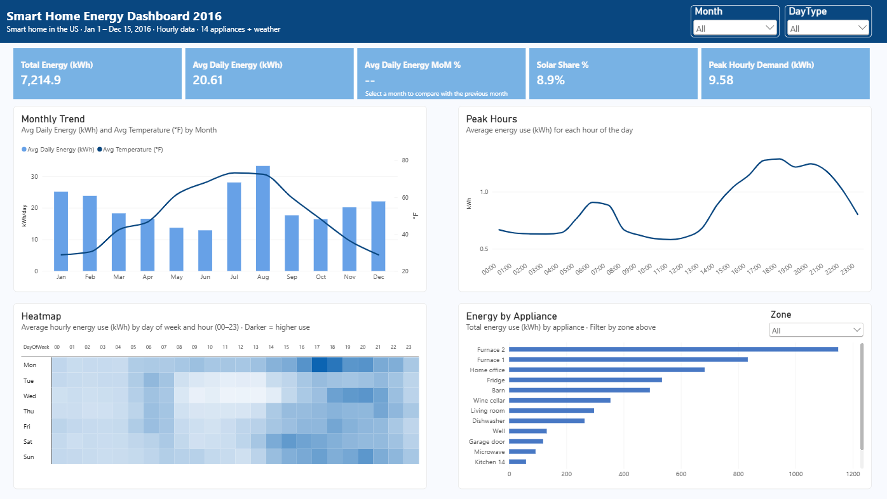

# Smart Home Energy Dashboard (Power BI)

An interactive Power BI dashboard that analyzes one year of smart-home IoT data to answer: **when, where, and why does this home use the most electricity?**



**Tools:** Power BI Desktop · Power Query (M) · DAX · Python (pandas)

---

## Key Insights

| # | Finding |
|---|---|
| 1 | **Evening is peak time.** Usage peaks at 17:00–18:00, about **2× higher** than late morning (10:00–12:00), the lowest point of the day. |
| 2 | **Heating is the largest load.** The two furnaces use ~2,000 kWh, nearly **2× any other zone**. Furnace use is ~3× higher on very cold hours (< 30°F) than on warm ones (> 70°F). |
| 3 | **Usage peaks in both summer and winter.** August had the highest daily use (**33.3 kWh/day**), 2.6× higher than June (12.9 kWh/day). |
| 4 | **Summer load is not explained by metered appliances.** None of the 14 metered appliances is an air conditioner, which suggests the summer increase comes from unmetered cooling. |
| 5 | **Solar covers little of the demand.** Solar panels generated only **8.9%** of total household use. |

---

## Dataset

- **Source:** [Smart Home Dataset with Weather Information (Kaggle)](https://www.kaggle.com/datasets/taranvee/smart-home-dataset-with-weather-information), file `HomeC.csv`
- **Size:** 503,910 rows × 32 columns
- **Content:** Power use (kW) of the whole house and 14 appliances, solar generation, and hourly weather (temperature, humidity, cloud cover, etc.)
- **Period:** Jan 1 – Dec 15, 2016 (one reading per minute)

---

## Project Workflow

### 1. Data Exploration & Cleaning
- Checked row counts, data types, nulls, and outliers with pandas.
- Removed null values and validated sensor ranges.

### 2. Data Transformation
Data quality issues found and fixed:

| Issue | Fix |
|---|---|
| **Wrong timestamp unit.** The `time` column increases by 1 per row as if in seconds, which would cover only 5.8 days. Row count (503,910 ≈ 350 days of minutes) and weather values that change every ~60 rows show the data is actually **per minute**. | Rebuilt the timeline with an index: `#datetime(2016,1,1,0,0,0) + #duration(0,0,[Index],0)`, then split into `Date` and `Time`. |
| **Text in a numeric column.** The first 58 rows of `cloudCover` contained the text `"cloudCover"` (a header leaked into the data). | Replaced with `null` instead of `0`, because 0 would wrongly mean "clear sky". |
| **Duplicate columns.** `House overall [kW]` = `use [kW]` and `Solar [kW]` = `gen [kW]` in every row. | Excluded the duplicates from the model. |
| **Wrong data types.** `visibility`, `precipIntensity`, `precipProbability` were auto-detected as Whole Number, rounding values like 0.0011 to 0. | Corrected to Decimal Number at the source step. |

### 3. Data Modeling
- **Aggregated minute data to hourly grain** (500K → 8.4K rows per hour), matching the questions the dashboard answers and keeping the model light.
- Built a **fact constellation (galaxy) schema** with two fact tables sharing conformed dimensions:

```
              Dim_Date ──────┬──────────────┐
                             │              │
Dim_Appliance ── Fact_Energy                Fact_House
                             │              │
              Dim_Hour ──────┴──────────────┘
```

| Table | Grain | Rows |
|---|---|---|
| `Fact_Energy` | Date × Hour × Appliance (kWh) | 117,586 |
| `Fact_House` | Date × Hour (total use, solar, weather) | 8,399 |
| `Dim_Date` | Day (month, weekday/weekend) | 350 |
| `Dim_Hour` | Hour (0–23, time of day) | 24 |
| `Dim_Appliance` | Appliance → Zone | 14 |

All relationships are one-to-many with single-direction filtering from dimensions to facts.

> Note: Appliance zones (Kitchen, Heating, Living Area, Storage & Outdoor) were assigned by me based on appliance names; the dataset does not include them.

### 4. DAX Measures
Key measures include:

```dax
Avg Daily Energy (kWh) =
AVERAGEX(VALUES(Dim_Date[Date]), [Total Energy (kWh)])

Avg Daily Energy PM (kWh) =
CALCULATE([Avg Daily Energy (kWh)], DATEADD(Dim_Date[Date], -1, MONTH))

Avg Daily Energy MoM % =
IF(
    HASONEVALUE(Dim_Date[Month]),
    DIVIDE([Avg Daily Energy (kWh)] - [Avg Daily Energy PM (kWh)], [Avg Daily Energy PM (kWh)])
)
```

**Why MoM uses daily average:** December has only 15 days of data. Comparing totals shows a misleading **−45%** drop versus November, while the daily average shows the real change: **+9%**.

Other measures: Total Energy, Solar Share %, Appliance Share %, Peak Hourly Demand, Avg Hourly Energy, Avg Temperature.

### 5. Dashboard Design
- **KPI cards:** Total energy, avg daily use, MoM change, solar share, peak hourly demand
- **Monthly Trend:** Avg daily energy (columns) vs. temperature (line, secondary axis)
- **Peak Hours:** Average use for each hour of the day
- **Heatmap:** Day of week × hour, colored by average use
- **Energy by Appliance:** Ranked bar chart with zone filter
- **Slicers:** Month, Weekday/Weekend, Zone. All visuals cross-filter each other.

---

## Assumptions & Limitations
- The start time (Jan 1, 2016 00:00) is inferred from the first Unix timestamp; day-of-week results depend on this assumption.
- Hourly values are averages of minute readings, so average kW over one hour equals kWh for that hour.
- `windBearing` (wind direction in degrees) is averaged linearly, which is inaccurate near north (0°/360°); it is not used in any visual.
- Data comes from a single house, so findings describe this home only.

---

## Files
| File | Description |
|---|---|
| `Smart_Home_Analyst.pbix` | Power BI report file |
| `images/dashboard.png` | Dashboard screenshot |
